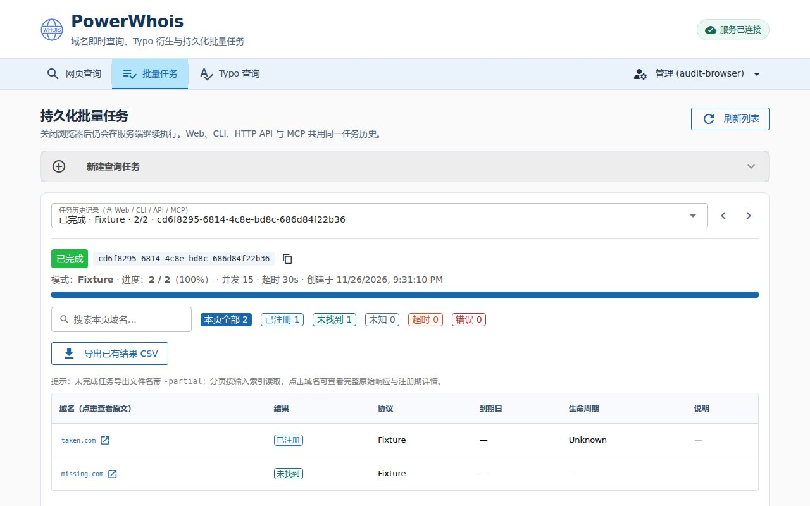

[English](README.md) | [中文](README.zh.md)

# PowerWhois

Domain research through the existing Web UI, a noninteractive CLI, a documented HTTP API, and an optional MCP adapter. One query core and one durable batch store; no AI vendor dependency.

- DNS, WHOIS/RDAP, Mixed, SOCKS5 proxy, custom query APIs and typo generation. Internationalized names support Unicode dots and an optional final root dot. RDAP retains the final source and response body. A gateway's HTML 404 is reported as an error. A registry's RDAP negative response is shown as `not_found`.
- Instant Web and Typo lookups with tab-preserved drafts, input normalization/deduplication, in-flight stop/recheck, clickable status filters, proxy indicators, friendly Chinese error messages, domain copy, and formula-safe CSV export. Each page keeps its own results, and Typo candidates never include the source domain.
- Durable batches with IDs, pause/resume/cancel, retry, lifecycle/expiry overview, in-page domain search, progress and paged exports. CLI CSV exports print the next input offset to stderr so the CSV can be redirected to a file.
- Accurate distinctions between registered, not_found, unknown, timeout and error, including WHOIS rate-limit classification, SOCKS5 proxy error diagnostics, and a built-in Settings proxy connectivity tester (`POST /api/admin/proxy/test`). DNS absence is not availability.
- Existing Web administration and explicitly confirmed manual registration remain available. Agent query credentials cannot register, delete data or change settings.
- Loopback binding by default; use SSH forwarding or an authenticated TLS gateway remotely.

Open a result to inspect or copy its upstream response. If a batch detail request fails, retry it in the dialog. When a restored batch's input or result counts disagree, the worker retains its evidence and runs the next batch. Check the affected task against a consistent Redis backup before resuming it.

## Deploy with Docker Compose

Install Docker Engine with the Compose v2 plugin on a Linux host. For a fresh installation, clone the repository and create a private environment file.

```sh
git clone https://github.com/WenLiCG/PowerWhois.git
cd PowerWhois/deploy
test -e .env || install -m 600 .env.example .env
${EDITOR:-vi} .env
```

Leave the fresh-install configuration directory at `./runtime/backend` and set the four credentials in `.env`. Choose an administrator username and a password of at least 12 characters. Generate independent random values of at least 32 characters for `POWERWHOIS_JWT_SECRET` and `POWERWHOIS_QUERY_TOKEN`. Keep `.env` outside version control.

```sh
sudo install -d -o 10001 -g 10001 -m 750 runtime/backend
sudo test ! -e runtime/backend/config.yaml && sudo install -o 10001 -g 10001 -m 600 backend/config.yaml runtime/backend/config.yaml
docker compose config --quiet
docker compose up -d --build
docker compose ps
curl -fsS --retry 12 --retry-connrefused --retry-delay 2 http://127.0.0.1:8080/healthz
```

The Compose stack builds the backend and Web UI from source. UID 10001 needs write access to the configuration directory because the settings page replaces the file atomically. Redis persists task data under `deploy/redis/redisdata`. Existing installations without `POWERWHOIS_CONFIG_DIR` still use `deploy/backend`. Preserve that directory and the existing environment file during upgrades. For a fresh install, configure a SOCKS server or registrar in Settings before selecting it.

Open `http://127.0.0.1:8080` and sign in with the administrator credentials. The port is bound to the host loopback interface. For a remote host, run `ssh -N -L 8080:127.0.0.1:8080 user@server` from your computer and open the same local URL. Use `docker compose logs --tail 100 typonamer caddy redis` to check startup.

## Native deployment

On Linux, install Go 1.27.4, Node.js 24, npm, make and Redis. From the repository root run `make -C src setup` followed by `make -C src all`. The binaries are in `dist/backend/` and the built Web UI is in `src/frontend/dist/spa/`. The deployment guide covers Redis configuration, the private environment file, `POWERWHOIS_WEB_ROOT`, the included systemd unit, and backup and migration steps for existing installations. [Native deployment, upgrades and rollback](docs/DEPLOYMENT.md)

## Documentation

[Current review, verification and upgrade notes](HANDOFF.md) · [Review and feature checklist](docs/REVIEW.md) · [CLI/API/MCP usage and permissions](docs/USAGE.md) · [Test report](docs/TEST-REPORT.md) · [OpenAPI](src/backend/api/openapi.json)



Licensed under the original [MIT license](LICENSE).
