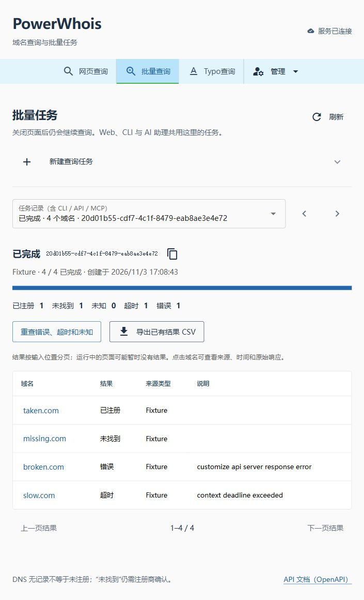

[English](README.md) | 中文

# PowerWhois

保留原有网页域名查询、批量任务、Typo、代理、自定义接口和管理功能，并增加不绑定 AI 厂商的 CLI、OpenAPI HTTP API 与可选 MCP。

- DNS、WHOIS/RDAP、Mixed、代理、自定义查询；结果区分已注册、未找到、未知、超时、错误。
- 批量任务有稳定 ID，支持暂停、继续、取消、重查、分页和部分导出；关闭浏览器或 CLI 后仍在服务端执行。
- Web、CLI、API、MCP 共用查询核心和批量任务库。
- AI 查询凭据不能注册、删数据或修改管理配置；原手动注册保留在管理员 Web，并要求确认。
- 默认只监听本机，远程使用 SSH 转发或受保护的 HTTPS 网关。

**未找到不等于可注册，DNS 无记录不等于未注册。**

## Docker Compose 部署

在 Linux 主机安装 Docker Engine 和 Compose v2 插件。首次部署时克隆仓库并创建私有环境文件。

```sh
git clone https://github.com/WenLiCG/PowerWhois.git
cd PowerWhois/deploy
install -m 600 .env.example .env
${EDITOR:-vi} .env
```

填写 `.env` 的四个变量。设置管理员用户名和至少 12 字符的密码，为 `POWERWHOIS_JWT_SECRET` 和 `POWERWHOIS_QUERY_TOKEN` 分别生成至少 32 字符的随机值。确保 `.env` 不进入 Git。

```sh
sudo chown 10001:10001 backend backend/config.yaml
sudo chmod 750 backend
sudo chmod 600 backend/config.yaml
docker compose config --quiet
docker compose up -d --build
docker compose ps
curl -fsS --retry 12 --retry-connrefused --retry-delay 2 http://127.0.0.1:8080/api/web/setting
```

Compose 从源码构建后端和网页。后端容器使用 UID 10001，保存设置时需要写入挂载的配置目录。Redis 任务数据保存在 `deploy/redis/redisdata`。

在主机打开 `http://127.0.0.1:8080`，使用配置的管理员账号登录。端口绑定在主机回环地址。部署到远程主机时，在自己的电脑运行 `ssh -N -L 8080:127.0.0.1:8080 user@server`，再打开同一地址。可用 `docker compose logs --tail 100 typonamer caddy redis` 查看启动日志。

## Linux 原生部署

安装 Go 1.27.4、Node.js 24、npm、make 和 Redis。在仓库根目录依次执行 `make -C src setup` 和 `make -C src all`。后端、CLI 与 MCP 二进制在 `dist/backend/`，网页在 `src/frontend/dist/spa/`。部署指南包含 Redis、私有环境文件、`POWERWHOIS_WEB_ROOT`、systemd 服务，以及已有实例的备份和迁移步骤。 [原生部署、升级与回滚](docs/DEPLOYMENT.md)

## 使用文档

- [完整审查、修复和功能对照](docs/REVIEW.md)
- [CLI / API / MCP 示例、权限与 AI 环境接入条件](docs/USAGE.md)
- [测试报告及未验证事项](docs/TEST-REPORT.md)
- [OpenAPI 3.0 文档](src/backend/api/openapi.json)；运行后 `/api/openapi.json`



沿用原项目 MIT 许可，见 [LICENSE](LICENSE)。

第二轮安全与正确性修复、接口兼容变化和新增测试见 [ROUND2.md](docs/ROUND2.md)。
