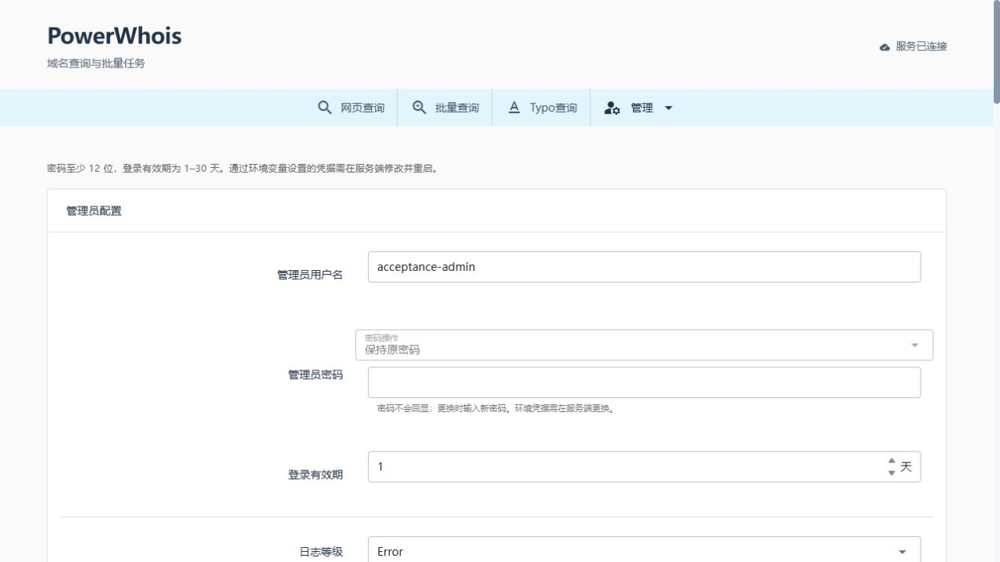

# 第二轮修复与验收

2026-11-03；基于 `89a29b6` 的实际源码和两份外部建议重新复现后实施。外部文档的 v1 补丁不是本仓库当前实现，未直接套用其代码或完成状态。

| 问题 | 本轮修改 | 检查 |
|---|---|---|
| GET 注册在复用连接断线时被 Go 自动重放 | 每笔使用独立、禁用连接复用的 HTTP/1 Transport；无重定向；提交前记录审计，发送审计 ID 作为 Idempotency-Key | 模拟上游收取第二笔请求后断开，原来 2 次调用产生 3 次请求，现在只有 2 次，第二次明确为不确定结果 |
| 重复提交及结果不确定 | 同一规范化域名 10 分钟内跨注册接口拦截；Redis 保存提交前意图及最终状态；超时/读取失败为 outcome_unknown；存储不可用时拒绝提交 | 模拟成功、重复提交拦截、断线/取消及持久化记录测试；无真实注册 |
| 设置向浏览器回传长期秘密 | GET/PUT 均不回传密码、JWT 密钥、代理密码、API URL；显式 keep/set/clear，URL 按已有名称留空保持；环境凭据不可在 Web 更换 | 真实鉴权 API 往返测试、配置单测、浏览器保存普通配置；配置读取/发布都深拷贝 |
| 保留域名与生命周期误判 | qa/ae 保留响应为 unknown，保留具体原因；Hold/Inactive 单独显示，陌生状态不猜为 Active | 保留/真实未找到 fixture，Hold、inactive、未知状态表驱动测试 |
| 静态后缀错误折叠目标 | 优先使用已有 x/net/publicsuffix 的 ICANN 规则，支持 wildcard/exception/IDN；私有托管后缀不当作注册局；静态表仅作旧规则后备 | foo.bar.ck、city.kawasaki.jp、例子.中国、blogspot.com 等边界测试 |
| 创建失败留下可执行的半任务 | 输入先暂存且带过期时间；发布脚本预检键类型/数量，检查写入结果，失败撤除索引；只有发布后任务才可执行 | WRONGTYPE 后无任务/队列/幂等残留；修复后可重新创建 |
| 创建成功但响应丢失后清理输入 | 清理暂存输入前原子检查是否已发布元数据 | 注入成功提交后丢响应，原幂等键取回同 ID，输入仍完整 |
| 租约只保护结果写入 | 创建、状态、恢复、迁移与结果脚本在 Redis 中校验所有者；结果计数错误在写入前拒绝，写失败撤销新结果；启动依据元数据重建队列 | 失去租约后创建/暂停/最终状态写入全被拒；错误计数和重复提交检查 |
| 分页响应过大 | 结果和导出分页受输入数量及约 8 MiB 编码预算双重限制；单条最大 16 MiB；普通结果默认摘要，单条详情取完整原文 | 17 条各含 2 MiB 原文及大字段分多页取齐，错误重查无跳过/重复；重启只读取结果存在标记；摘要不夹带原文 |
| 同步响应和前端竞态 | 同步原文预览每域名 64 KiB，总编码预算 8 MiB，超限返回 413；结果响应核对任务/页码/请求序号，控制期间禁止切换任务，导出跟随服务器游标 | 大同步响应拒绝、迟到第一页不覆盖第二页；浏览器原文加载与 CSV 4 条记录核对 |

Go：`go test -race ./...`、`go vet ./...`。前端：`npm test`（4 项）、lint、production build。实际 API/CLI/MCP/管理员 API 进程一致性与重启验收仍使用 `tools/acceptance.py`。本轮在浏览器验证了设置保持秘密后保存、摘要打开原文、CSV 下载、退出登录；此前的移动端和批量控制记录保留于 TEST-REPORT。

## 升级时的行为变化

- 更新网页与后端要同时进行。旧管理客户端修改秘密必须显式传 `secretActions`；仅回传空字符串不会清空凭据。旧管理客户端 PUT 不带 secretActions 时保持原秘密；新建或重命名 API 必须重新提供 URL，删除接口条目就是删除该配置。
- `/api/v1/tasks/{id}/results` 默认 `includeRaw=false`；需要原文可用 `includeRaw=true` 或 `/results/{index}`。导出默认保留原文，CSV 不含原文列。
- 任何分页客户端都必须跟随 `nextOffset` 或 `X-Next-Offset`，不能自行加 limit；软字节上限可能使一页少于 limit。超过 8 MiB 的单条结果独占一页，16 MiB 以上的历史异常记录拒绝返回。
- 同步 `/query` 是预览入口：`rawResponseTruncated=true` 表示原文截断。需要完整证据和重连恢复时先创建持久任务；同步响应超限返回 `413 response_too_large`。
- 导出提供 `X-Task-State`、`X-Export-Consistency`。运行/暂停/取消/失败任务均标记 partial；只有 completed 标记 complete。该标记不承诺跨页时间快照。Web 部分导出文件名带 `-partial`。
- 错误重查任务记录 `parentTaskId`。注册记录位于 `powerwhois:registration:<auditId>`，守卫位于 `powerwhois:registration-guard:*`，应包含在备份和 Redis ACL 中。记录只含域名、接口名称、状态和时间，不保存 URL、密码或原始注册响应。
- 发生崩溃后仍停留 submitting 的记录，按结果不确定处理。10 分钟守卫不是注册商的 exactly-once 保证；即使守卫过期也应先人工核对。Idempotency-Key 是否去重由注册商决定，未验证支持时不能据此保证不重复收费。

旧版若已把输入错误折叠为公共后缀，可能在新的后缀校验中被拒绝查询或导入，应保留备份并人工核对目标，不应为兼容继续查询错误域名。

## 保留的边界

不自动购买，不在本轮连接生产注册商、AI 账号或线上数据库。任务仍单租户单活，协议冷却和当前查询配置仍在进程中；未新增完整 OAuth、多租户、配置版本快照、历史自动清理或 RDAP 客户端缓存。管理员密码仍由受保护配置/环境提供，本轮优先关闭回传并明确修改语义，未做密码哈希和服务端 Secrets `_FILE` 迁移。生产部署、断电/磁盘满和真实回滚仍需目标环境验收。

