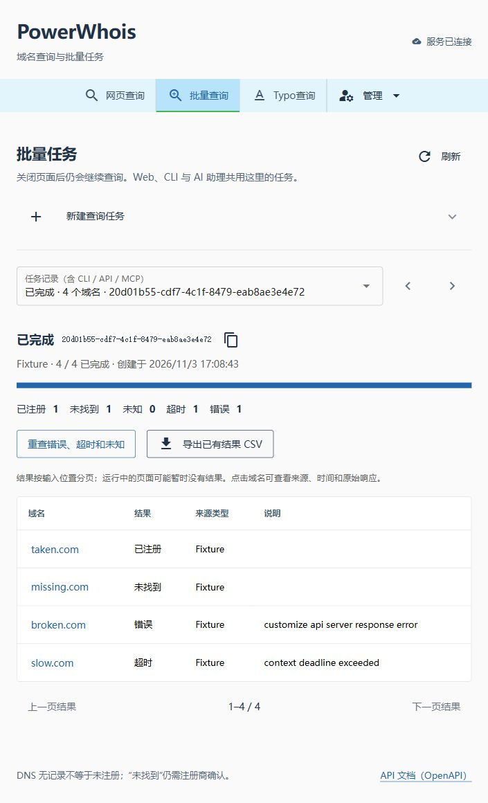
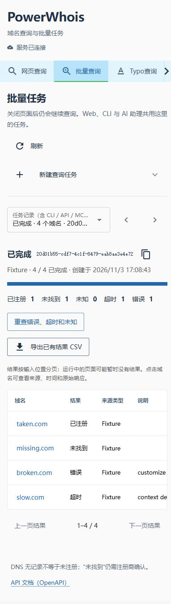

# 验收记录

日期：2026-11-03。Windows 主机 + WSL Ubuntu；Go 1.27.3、Node 24.14.0、WSL Redis 8.0.5。测试使用独立临时 Redis，未访问原生产数据库。部署模板仍使用 Redis 7，7.x 容器组合未在本机实跑。

最新补充：[第二轮修复与验收](ROUND2.md)。已覆盖注册底层重发、秘密 API 往返、PSL、存储错误/丢响应/租约和大结果/前端竞态；本轮没有真实注册、线上部署或账号接入。

## 已执行

| 检查 | 结果和范围 |
|---|---|
| `go test -race ./...` | 通过。真实隔离 Redis、任务生命周期、迁移、API、WS 鉴权、CLI、MCP SDK、查询分类、限流、配置、日期及 CSV |
| `go vet ./...` | 通过 |
| Linux 后端/CLI/MCP 构建 | 通过，实际进程验收通过 |
| Windows amd64 CLI/MCP 交叉构建 | 通过；Windows CLI help 可执行；具体 AI 客户端加载未验证 |
| `npm test` | 4 个测试通过：重复消息/断线/重查计数，表单规则，空设置兼容 |
| `npm run lint` / `npm run build` | 通过；生产 JS 合计约 513 KB，CSS 约 305 KB（未压缩，不含字体）；没有性能跑分承诺 |
| `python3 tools/acceptance.py` | 通过：实际后端、独立 Redis、模拟上游、真实 CLI 与 stdio/HTTP MCP 进程 |
| 浏览器操作 | Web 四种结果状态、登录、上传 40 域名 TXT、暂停/继续/取消、部分结果、CSV 下载、Typo 7 候选、管理配置保存通过 |
| 响应式 | 正常窗口和 390×844 检查；390px 页面没有整体横向溢出，表格保留内部滚动 |
| Impeccable detector | 本轮一次扫描，返回 `[]`；以实际浏览器结果为最终依据 |
| `git diff --check` | 通过 |

### 跨入口一致性

模拟域名 `taken.com/missing.com/broken.com/slow.com` 分别得到 registered/not_found/error/timeout。真实 Web 即时查询、HTTP 同步查询、CLI 同步查询结果状态一致。CLI 创建任务后，管理员 Web API 和 MCP 使用同一幂等键得到相同任务 ID；Web 页面可直接选到该 ID。HTTP、CLI、MCP、管理员 Web API 获取该持久化任务时，JSON 对象内容一致（包含来源和查询时间）。独立执行的即时查询有不同查询时间，不要求它们的完整响应逐字节相同。

实际浏览器下载 CSV 后检查表头、4 条记录和状态。API/CLI/MCP 的 JSON 导出按页面比较；不把模型对 CSV 的自然语言描述当作导出一致性证明。

### 异常与安全

- 302 个规范化域名、32 个 worker，验证并发不超过配置；20 个同时重复创建请求返回相同 ID，改变参数复用键为冲突。
- 暂停后计数不再增长；中途停止 worker 后新实例恢复同一 ID；取消不可恢复，部分结果仍可取；错误/超时/未知重查生成新 ID。
- 旧单批输入和 DNS Free 迁移为暂停任务/unknown；重复导入只有一个新任务，原键和无关键不变。
- 慢 HTTP 响应按域名超时，其他域名照常完成；429 Retry-After 等待可被总 deadline 终止；超大响应读取失败；不信任的 TLS 证书被拒。
- RDAP 测试包含 200 隐私删减对象、404、500、429、错误域名对象。WHOIS 日期测试覆盖 `1st August` 与 `23rd August`。
- 匿名、查询 token 无权管理/注册；WebSocket 跨 Origin 被拒；注册需要确认；服务端拒绝超量与非法域名；真实注册完全使用 mock。
- 配置特殊 YAML 字符往返正确；非法更新不覆盖原文件；环境凭据不写入 config；验收日志不含测试密码/token/JWT。
- 官方 MCP SDK 验证工具 schema 与结构化输出，错误参数类型被拒；HTTP MCP 验证缺少 Bearer 的拒绝和合法凭据握手。

### 小样本真实查询

对 Verisign HTTPS RDAP 执行两次只读查询：`example.com` 返回 registered；唯一测试名称 `powerwhois-acceptance-20261103-a7b9d281.com` 返回 not_found。来源均记录为实际 RDAP URL。未注册/购买任何域名；这不代表覆盖全部 TLD 或真实代理线路。

### 依赖审计

- npm 初始报告 39 项（含 3 critical、26 high）；升级构建工具和兼容依赖后，`npm audit --omit=dev` 为 **0**。
- 完整 npm audit 为 **12 moderate，0 high，0 critical**，均由开发 lint/glob 工具链的 [minimatch 公告 GHSA-g3hv-75wg-m249](https://github.com/advisories/GHSA-g3hv-75wg-m249) 传播。没有盲目 `audit fix --force` 降级或覆盖不兼容依赖；开发环境不要把不可信 glob 当作 lint 输入。
- 最新构建工具链与 Redis/fasthttp/compress 修复版本下，govulncheck：**0 受影响调用、0 导入包级漏洞**；剩余 1 条仅模块级 [未使用 openpgp 公告](https://pkg.go.dev/vuln/GO-2026-5932)。不宣称所有依赖完全无漏洞。

## 可重复执行

```sh
cd src/backend
go test -race ./...
go vet ./...
mkdir -p ../../.work
go build -o ../../.work/typonamer .
go build -o ../../.work/powerwhois ./cmd/powerwhois
go build -o ../../.work/powerwhois-mcp ./cmd/powerwhois-mcp
cd ../..
python3 tools/acceptance.py
cd src/frontend
npm ci
npm test
npm run lint
npm run build
npm audit --omit=dev
```

`tools/acceptance.py --serve` 保留临时模拟后端在 8080，配合前端 dev 8090 做浏览器验收，Ctrl+C 清理自身进程/临时数据。该脚本有固定的**仅测试**账号，禁止把它作为正式部署方式；查询/MCP/JWT token 每次随机生成。运行时拷贝二进制到临时目录，避免重新构建覆盖正在执行的文件。

## 尚未验收

目标服务器上的 Docker/systemd 安装、Redis 7 容器组合、线上历史数据真实迁移/回滚、百万域名或长时间压力、整机断电/磁盘满故障、真实 SOCKS 代理、所有 TLD/WHOIS 格式、真实付费注册、ChatGPT dot/Grok/Codex 账号级接入。没有推送或部署到公网。CI 工作流已提供，但未在 GitHub Actions 云端触发。

## 界面留档




