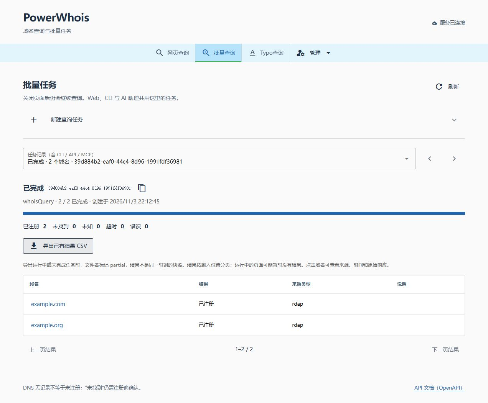

# VPS 部署验收与运维交接

2026-11-03，在用户指定的 Debian 12 / amd64 VPS 实际部署。Web、API、CLI、MCP 共用本版查询核心和 Redis 任务库；只监听回环地址。公网现有 Docker 服务未调整。正式发布对应的源码提交、程序校验值和前端校验值记录在服务器 `/opt/powerwhois/current/manifest.json`，交付 ZIP 的 `DELIVERY.txt` 记录源码提交。

## 当前部署

| 项目 | 路径或配置 |
|---|---|
| 发布目录 | `/opt/powerwhois/releases/`，`/opt/powerwhois/current` 原子切换软链接 |
| Web/API | `powerwhois.service`，`127.0.0.1:8080` |
| HTTP MCP | `powerwhois-mcp.service`，`127.0.0.1:8081/mcp` |
| Redis 7.0.15 | `powerwhois-redis.service`，`127.0.0.1:6381`，独立数据目录 `/var/lib/powerwhois-redis` |
| 后端配置与日志 | `/var/lib/powerwhois/runtime-v2/config.yaml`、`logs/`；DynamicUser 的宿主实际路径位于 `/var/lib/private/powerwhois/` |
| 后端环境文件 | `/etc/powerwhois/service.env`，root 0600 |
| MCP 环境文件 | `/etc/powerwhois/mcp.env`，root 0600；仅入口与查询凭据，无管理员/Redis 凭据 |
| Redis 配置 | `/etc/powerwhois/redis.conf`，root:redis 0640 |
| 验收报告 | `/opt/powerwhois/verification/vps-r2.json`，无凭据 |

Redis 开启 AOF everysec、noeviction、512 MiB 内存上限，应用 ACL 限制键前缀并禁止 FLUSHDB 等危险命令。后端 systemd 内存上限 700 MiB，MCP 256 MiB。默认全局批量并发 32；DNS/WHOIS/RDAP 分别有独立并发、速率与超时。真实注册商配置为空，避免发生付费交易。

管理员使用部署时生成的强密码。管理员密码、查询 token 和 MCP token 仅保存在受保护的本机交接文件与服务器环境文件，不能加入仓库、截图或共享报告。凭据不是安装包的一部分。完整 Web 含原匿名即时查询入口，因此继续保持 SSH 隧道访问；公网发布须先配置全站认证和 HTTPS。

## 实际验证

- 自动化 VPS 验收共 29 项：网页与 SPA/静态资源；未知 API 404；匿名与查询 token 权限；隐藏秘密的管理设置读取和原子保存；非法输入；全部 Typo 类型与后缀生成；DNS/WHOIS/RDAP/Mixed 真实查询；任务、证据、CSV；API/CLI/HTTP MCP 导出一致；WebSocket Origin、认证和注册确认边界；日志 ZIP 与秘密扫描；systemd 重启后结果完整一致、MCP 可继续使用。
- 真实查询：`example.com`、`example.org` 的 RDAP 返回 registered；随机唯一 `.com` 名称返回 not_found，同一名称 DNS 无委派返回 unknown。`example.de` 的真实 WHOIS 来源为 whois.denic.de。保留来源和时间，不将 not_found 承诺为可注册。
- VPS 上独立临时 Redis + 模拟上游：300 域名、并发 32，全部完成；暂停后计数稳定，恢复继续，取消保留部分结果；20 次并发重复提交返回同一 ID；SIGKILL 后等待租约过期并重启，12 个域名恢复完成，无重复结果序号。该测试不向注册局施加批量压力。
- Windows CLI 经 SSH 隧道读取 VPS 任务成功；Windows stdio MCP 完成官方 SDK 协议初始化、11 个查询工具列表和任务读取。HTTP MCP 无 Bearer 被拒，合法 Bearer 握手/调用通过。
- 实际浏览器经 SSH 隧道登录，查看同一持久化任务并下载 CSV，文件包含两条 registered 记录。没有将嵌入式浏览器验证等同于独立 ChatGPT dot/Grok 账号接入。
- Go race 全套测试及 vet 通过；新增原生 Web 路由、日志 ZIP/清空使用可写目录的回归测试。此前前端测试、lint、生产构建通过，本次未改前端源码。

复测（VPS，root；会保存相同配置并重启后端一次）：

```sh
python3 /opt/powerwhois/current/vps_acceptance.py
systemctl is-active powerwhois powerwhois-mcp powerwhois-redis
```

隔离模拟压测：在源码根目录准备三个 `.work/` Linux 二进制和 `redis-server` 后，运行 `python3 tools/acceptance.py --stress`。脚本使用临时目录、临时 Redis 与模拟注册商，不访问正式任务库。

## 旧版保护、升级与回滚

接手时运行的是之前另一次改版，使用 bbolt `jobs.db`，不是本版 Redis 格式。已先停止旧服务，备份整个旧状态目录、旧 unit 和 current 目标，再核对归档内 jobs.db 的 SHA-256。该文件未自动导入新任务库。部署前磁盘仅余约 1.4 GiB；核验备份后清理同项目重复旧备份/旧发布和已归档的旧原始数据库，保留可回滚版本，部署后约余 2.5 GiB。

保留备份：`/opt/powerwhois/backups/before-vps-r2-20261103-140802/`，包含 `legacy-state.tar.gz`、旧 unit 与旧软链接目标。旧可运行发布 `/opt/powerwhois/releases/20261103-live-bed7874dde13` 保留。不要把旧程序直接指向新 Redis 或新运行配置。

回滚须在维护窗口操作：

1. 导出所需新任务，停止 `powerwhois-mcp.service` 与 `powerwhois.service`；停止独立 Redis 后备份其完整目录和 `/etc/powerwhois`（包含秘密，限制权限）。
2. 按备份 `current.txt` 切回旧发布；恢复备份的旧 `powerwhois.service`。把 `legacy-state.tar.gz` 解压到一个受保护的临时目录，核对文件后将旧状态恢复至旧 unit 的工作目录。保留 `runtime-v2` 和新 Redis 数据，禁止用覆盖整个目录的方式丢弃新数据。
3. `systemctl daemon-reload`，仅启动旧 `powerwhois.service`，检查旧健康接口和旧任务数；旧版无本版独立 MCP 服务。回滚不会自动合并新任务。

后续同版本发布无需重建凭据或 Redis：备份配置/数据库，构建不可变发布目录，校验 SHA-256，停止后端与 MCP，原子切换 current，再启动并运行验收。日志放可写运行目录，网页由 `POWERWHOIS_WEB_ROOT` 指定，程序目录保持只读。

## 容量与未验证边界

当前约 2.5 GiB 可用磁盘不能支撑无限历史积累；原始响应、Redis AOF 和备份会增长。大规模任务前检查 `df -h /`、Redis 内存和任务结果体积，另做外部受保护备份。本版没有自动删除历史结果的策略。

未做：真实付费注册、真实 SOCKS 代理、全部 TLD、百万域名/长期负载、整机断电/磁盘满、实际回滚演练、Docker 运行、ChatGPT dot/Grok 云端账号连接。MCP 接入能力取决于具体客户端、认证和网络条件。


